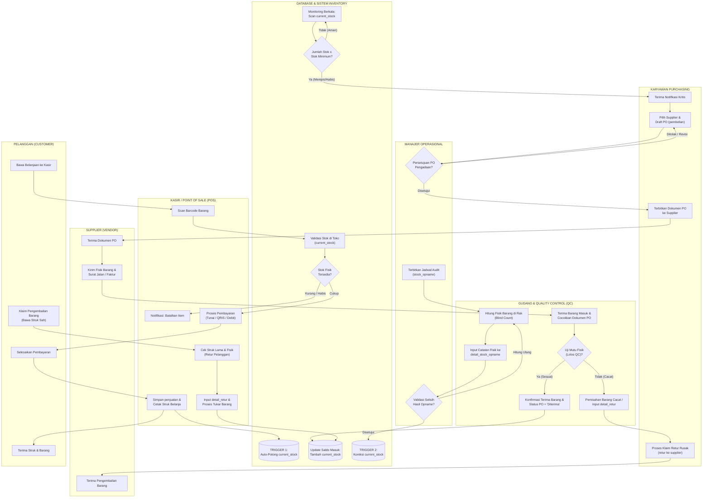
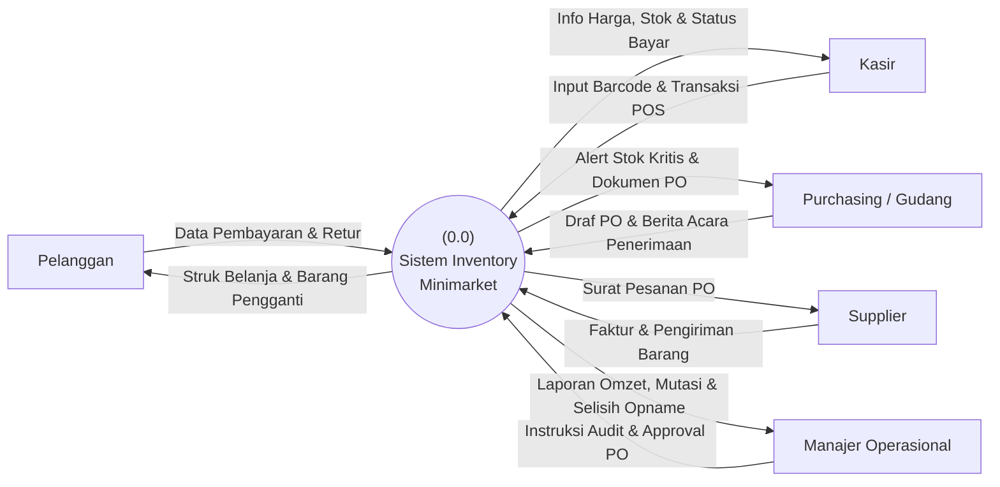
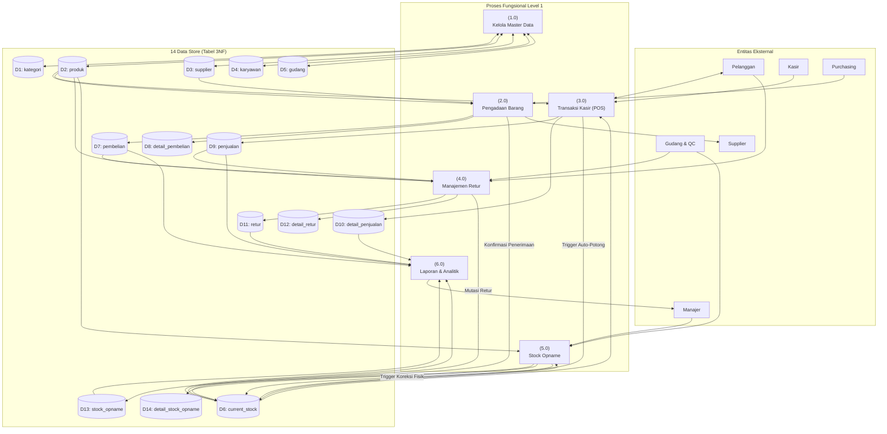
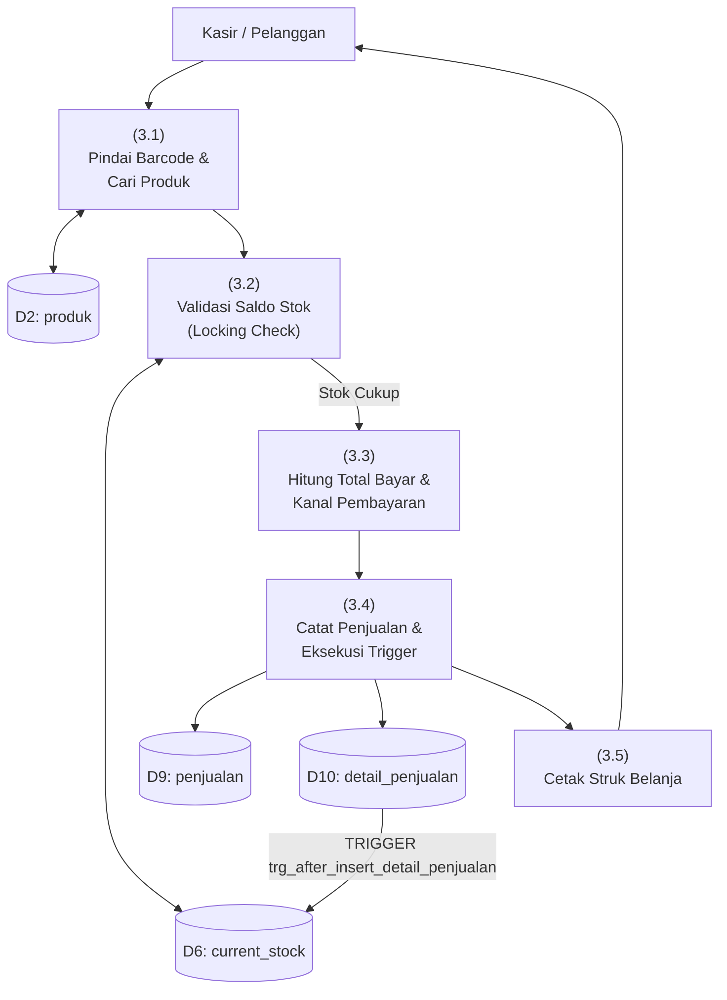

# LAPORAN PERANCANGAN DAN IMPLEMENTASI SISTEM INFORMASI BASIS DATA
## SISTEM MANAJEMEN STOCK-INVENTORY MINIMARKET
**Mata Kuliah:** Basis Data / Praktikum Basis Data  
**Dosen Pengampu:** Ibu Dian  
**Arsitektur Sistem:** Full-Stack Node.js (Express.js) + MySQL 8.4 (14 Tabel 3NF)  

---

## DAFTAR ISI
1. [Narasi Proses Bisnis (10 Alur Bisnis Minimarket)](#1-narasi-proses-bisnis)
2. [Business Process Flow Diagram (BPFD Swimlane)](#2-business-process-flow-diagram-bpfdi)
3. [Diagram Berjenjang (Hierarchy Chart)](#3-diagram-berjenjang-hierarchy-chart)
4. [Data Flow Diagram (DFD Level 0, Level 1, Level 2)](#4-data-flow-diagram-dfd)
5. [Entity Relationship Diagram (ERD) & Kamus Data 14 Tabel (3NF)](#5-entity-relationship-diagram-erd--kamus-data)
6. [Prinsip Transaksi ACID & Implementasi Database Triggers](#6-prinsip-transaksi-acid--triggers)
7. [Laporan Black Box Testing (Monitoring vs Control: TC-01 s.d TC-10)](#7-laporan-black-box-testing)

---

## 1. Narasi Proses Bisnis

Sistem Manajemen Stock-Inventory Minimarket dirancang untuk mengintegrasikan proses operasional ritel mulai dari pengadaan barang ke pemasok, pengelolaan persediaan multilocational (toko vs gudang), kasir penjualan (Point of Sale), penanganan retur barang cacat, audit fisik persediaan (stock opname), hingga pelaporan analitik bisnis.

Berikut adalah **10 Alur Proses Bisnis Utama**:

1. **Proses Monitoring Stok Kritis & Peringatan Ambang Batas (Safety Stock Alert)**  
   Sistem basis data secara berkala memantau tabel snapshot `current_stock`. Bila saldo persediaan produk $\le$ `stok_minimum`, sistem otomatis menetapkan status `'Menipis'`. Jika saldo bernilai $0$, status menjadi `'Habis'`. Informasi ini ditampilkan pada dashboard manajerial dan menjadi pemicu bagian Purchasing untuk menerbitkan purchase order.

2. **Proses Perencanaan & Pembuatan Purchase Order (PO Pengadaan)**  
   Staf Purchasing memilih vendor terdaftar dari master `supplier`, menentukan daftar produk, jumlah pesanan, dan estimasi harga beli. Dokumen PO disimpan ke tabel `pembelian` dan `detail_pembelian` dengan status pembayaran awal `'Belum Lunas'`.

3. **Proses Persetujuan Anggaran (Approval Management)**  
   Manajer Operasional meninjau draf PO pengadaan. Jika anggaran dan kuantitas disetujui, dokumen PO diterbitkan secara resmi dan dikirimkan kepada pihak supplier.

4. **Proses Pengiriman & Penerimaan Fisik Barang Masuk (Goods Receipt)**  
   Supplier mengirimkan fisik barang beserta faktur/surat jalan. Staf Gudang dan tim Quality Control (QC) memeriksa fisik barang, mencocokkan jumlah dan spesifikasi dengan dokumen PO.

5. **Proses Konfirmasi Penerimaan & Pembaruan Stok Masuk**  
   Jika barang lolos uji mutu, staf mengonfirmasi penerimaan pada sistem (`POST /api/purchases/:id/receive`). Status PO diperbarui menjadi `'Diterima'`, kuantitas saldo pada `current_stock` otomatis bertambah sesuai item yang masuk, dan status stok diperbarui ke `'Aman'`.

6. **Proses Transaksi Penjualan Kasir (Point of Sale / POS)**  
   Pelanggan membawa barang ke kasir. Kasir memindai barcode EAN-13 produk. Sistem memvalidasi ketersediaan stok fisik di etalase toko. Jika stok mencukupi, kasir memproses pembayaran (Tunai, Debit, atau QRIS).

7. **Proses Pemotongan Stok Kasir Otomatis (Database Trigger Mutation)**  
   Saat transaksi disimpan ke tabel `penjualan` dan `detail_penjualan`, engine MySQL mengeksekusi `TRIGGER trg_after_insert_detail_penjualan`. Trigger ini secara otomatis memotong kolom `jumlah_stok` pada `current_stock` etalase toko dan memperbarui status persediaan secara atomic. Kasir kemudian mencetak struk belanja digital bagi pelanggan.

8. **Proses Retur Pembelian ke Supplier (Klaim Barang Cacat / Expired)**  
   Barang yang rusak, kadaluarsa, atau tidak sesuai spesifikasi dipisahkan oleh bagian Gudang. Petugas mencatat berita acara retur pada tabel `retur` dan `detail_retur` dengan jenis `'Ke Supplier'`. Saldo persediaan pada `current_stock` otomatis dikurangi agar tidak terbawa dalam stok aktif siap jual.

9. **Proses Retur Penjualan dari Pelanggan (Pengembalian Konsumen)**  
   Pelanggan yang membawa struk sah dapat menukarkan barang yang cacat atau keliru dibeli. Kasir memproses retur jenis `'Dari Pelanggan'`, mencatat barang dan alasan retur ke `detail_retur`, serta mengembalikan kuantitas barang ke saldo `current_stock`.

10. **Proses Audit Fisik Persediaan Berkala (Stock Opname & Rekonsiliasi)**  
    Petugas gudang melakukan perhitungan fisik nyata secara independen (*blind count*) di rak penyimpanan. Hasil hitungan dimasukkan ke form stock opname. Sistem membandingkan `stok_fisik` dengan `stok_sistem`, menghitung `selisih`, menentukan `jenis_penyesuaian` ('Penambahan' / 'Pengurangan' / 'Tetap'), dan menyimpannya ke `detail_stock_opname`. Engine basis data memicu `TRIGGER trg_after_insert_detail_stock_opname` untuk langsung mengoreksi saldo `current_stock` agar 100% sinkron dengan fakta fisik.

---

## 2. Business Process Flow Diagram (BPFD)

Diagram Swimlane lintas aktor berikut memetakan pembagian tanggung jawab antara **Pelanggan**, **Kasir**, **Purchasing**, **Gudang & QC**, **Manajer Operasional**, serta **Sistem Basis Data**:



---

## 3. Diagram Berjenjang (Hierarchy Chart)

Diagram berjenjang memetakan struktur modular sistem informasi dari Sistem Utama (Level 0) ke dalam 6 Fungsi Proses Level 1 dan rincian sub-proses Level 2:

```
[0.0 SISTEM MANAJEMEN STOCK-INVENTORY MINIMARKET]
│
├── [1.0 PENGELOLAAN MASTER DATA]
│   ├── 1.1 Kelola Kategori Produk
│   ├── 1.2 Kelola Master Produk (Barcode EAN-13, Harga, Satuan)
│   ├── 1.3 Kelola Data Supplier & Kontak PIC
│   ├── 1.4 Kelola Data Karyawan & Shift Kerja
│   └── 1.5 Kelola Lokasi Gudang & Toko
│
├── [2.0 MONITORING & PENGADAAN (PROCUREMENT)]
│   ├── 2.1 Pemantauan Stok Kritis (Menipis / Habis)
│   ├── 2.2 Pembuatan Draft Purchase Order (PO)
│   ├── 2.3 Persetujuan Anggaran Manajer
│   └── 2.4 Penerimaan Barang & Update Stok Masuk
│
├── [3.0 PENJUALAN KASIR (POINT OF SALE)]
│   ├── 3.1 Pemindaian Barcode & Pencarian Barang
│   ├── 3.2 Validasi Saldo Stok Kasir (Control Layer)
│   ├── 3.3 Eksekusi Checkout Transaksi ACID
│   ├── 3.4 Pemotongan Stok Otomatis via Trigger
│   └── 3.5 Pencetakan Struk Digital & Bukti Bayar
│
├── [4.0 MANAJEMEN RETUR BARANG]
│   ├── 4.1 Pencatatan Retur Pembelian ke Supplier
│   ├── 4.2 Pemotongan Stok Barang Cacat
│   ├── 4.3 Pencatatan Retur Penjualan dari Pelanggan
│   └── 4.4 Pengembalian Stok Layak ke Etalase Toko
│
├── [5.0 AUDIT FISIK (STOCK OPNAME)]
│   ├── 5.1 Penjadwalan Audit Fisik per Gudang
│   ├── 5.2 Pencatatan Hasil Hitung Fisik (Blind Count)
│   ├── 5.3 Kalkulasi Selisih & Penentuan Jenis Penyesuaian
│   └── 5.4 Koreksi Saldo Otomatis via Trigger Opname
│
└── [6.0 PELAPORAN & ANALITIK BISNIS]
    ├── 6.1 Laporan Real-Time Persediaan (KPI Dashboard)
    ├── 6.2 Rekap Penjualan, Omzet, & Analisis Kanal Bayar
    ├── 6.3 Analisis Produk Fast-Moving (Terlaris)
    ├── 6.4 Kartu Mutasi Stok Komprehensif (Audit Movement)
    └── 6.5 Ekspor Data Ringkasan ke CSV / Cetak Laporan
```

---

## 4. Data Flow Diagram (DFD)

### 4.1 Context Diagram (DFD Level 0)

Memetakan interaksi aliran data antara sistem tunggal dengan 5 entitas eksternal:



---

### 4.2 DFD Level 1 (Proses Utama & 14 Data Store)

Memetakan proses fungsional utama yang saling bertukar data dengan 14 *Data Store* (`D1` s.d `D14`):



---

### 4.3 DFD Level 2: Dekomposisi Proses Penjualan Kasir (Proses 3.0)



---

## 5. Entity Relationship Diagram (ERD) & Kamus Data

### 5.1 Struktur Normalisasi Basis Data (3NF)
Seluruh 14 tabel dirancang memenuhi **Bentuk Normal Ketiga (3NF)**:
* **1NF:** Tidak ada atribut bernilai ganda (*atomic values*), setiap baris memiliki Primary Key unik.
* **2NF:** Seluruh atribut bukan-kunci memiliki ketergantungan fungsional penuh pada Primary Key (tidak ada ketergantungan parsial; contohnya rincian barang dipisahkan ke `detail_pembelian` dan `detail_penjualan`).
* **3NF:** Mengeliminasi ketergantungan transitif di mana atribut bukan-kunci bergantung pada atribut bukan-kunci lainnya (misalnya nama supplier tidak disimpan di tabel produk atau pembelian, melainkan direferensikan melalui `id_supplier`).

---

### 5.2 Kamus Data 14 Tabel (Data Dictionary)

#### 1. Tabel `kategori` (Master)
| Nama Kolom | Tipe Data | Keterangan / Constraint |
|---|---|---|
| `id_kategori` | `BIGINT UNSIGNED` | Primary Key, Auto Increment |
| `nama_kategori` | `VARCHAR(100)` | Not Null, Unique (Klasifikasi produk) |
| `deskripsi` | `VARCHAR(255)` | Nullable, deskripsi singkat kategori |

#### 2. Tabel `supplier` (Master)
| Nama Kolom | Tipe Data | Keterangan / Constraint |
|---|---|---|
| `id_supplier` | `BIGINT UNSIGNED` | Primary Key, Auto Increment |
| `nama_supplier` | `VARCHAR(120)` | Not Null, nama badan usaha pemasok |
| `alamat` | `VARCHAR(255)` | Nullable, alamat fisik pemasok |
| `no_telepon` | `VARCHAR(30)` | Nullable, nomor kontak operasional |
| `email` | `VARCHAR(160)` | Nullable, Unique, email resmi |
| `kontak_person` | `VARCHAR(120)` | Nullable, nama perwakilan sales |

#### 3. Tabel `karyawan` (Master)
| Nama Kolom | Tipe Data | Keterangan / Constraint |
|---|---|---|
| `id_karyawan` | `BIGINT UNSIGNED` | Primary Key, Auto Increment |
| `nama_karyawan` | `VARCHAR(120)` | Not Null, nama lengkap karyawan |
| `jabatan` | `VARCHAR(60)` | Not Null ('Kasir', 'Gudang', 'Purchasing', 'Manager') |
| `no_telepon` | `VARCHAR(30)` | Nullable, nomor kontak HP |
| `shift_kerja` | `VARCHAR(40)` | Nullable ('Pagi', 'Siang', 'Reguler') |

#### 4. Tabel `gudang` (Master)
| Nama Kolom | Tipe Data | Keterangan / Constraint |
|---|---|---|
| `id_gudang` | `BIGINT UNSIGNED` | Primary Key, Auto Increment |
| `nama_gudang` | `VARCHAR(120)` | Not Null, Unique ('Toko Utama', 'Gudang Belakang') |
| `lokasi` | `VARCHAR(255)` | Nullable, area rak penempatan |
| `kapasitas` | `INT UNSIGNED` | Not Null, Default 0 |

#### 5. Tabel `produk` (Master)
| Nama Kolom | Tipe Data | Keterangan / Constraint |
|---|---|---|
| `id_produk` | `BIGINT UNSIGNED` | Primary Key, Auto Increment |
| `id_kategori` | `BIGINT UNSIGNED` | FK -> `kategori(id_kategori)` ON UPDATE CASCADE ON DELETE RESTRICT |
| `barcode` | `VARCHAR(13)` | Not Null, Unique (Standar valid EAN-13) |
| `nama_produk` | `VARCHAR(160)` | Not Null, nama merek barang dagang |
| `satuan` | `VARCHAR(30)` | Not Null, Default 'pcs' |
| `harga_beli` | `DECIMAL(14,2)` | Not Null, Default 0 (HPP pengadaan) |
| `harga_jual` | `DECIMAL(14,2)` | Not Null, harga kasir etalase |
| `stok_minimum` | `INT UNSIGNED` | Not Null, Default 5 (Ambang batas safety stock) |
| `aktif` | `BOOLEAN` | Not Null, Default TRUE (Status katalog) |

#### 6. Tabel `current_stock` (Snapshot Real-Time)
| Nama Kolom | Tipe Data | Keterangan / Constraint |
|---|---|---|
| `id_current_stock` | `BIGINT UNSIGNED` | Primary Key, Auto Increment |
| `id_produk` | `BIGINT UNSIGNED` | FK -> `produk(id_produk)` ON UPDATE CASCADE ON DELETE RESTRICT |
| `id_gudang` | `BIGINT UNSIGNED` | FK -> `gudang(id_gudang)` ON UPDATE CASCADE ON DELETE RESTRICT |
| `jumlah_stok` | `INT` | Not Null, Default 0 (CHECK `jumlah_stok >= 0`) |
| `stok_minimum` | `INT UNSIGNED` | Not Null, Default 5 (Redundansi terkontrol performa) |
| `status_stok` | `ENUM` | Not Null, Default 'Habis' ('Aman', 'Menipis', 'Habis') |
| `tanggal_update` | `TIMESTAMP` | Not Null, Default CURRENT_TIMESTAMP ON UPDATE CURRENT_TIMESTAMP |
| *Constraint Khusus* | `UNIQUE KEY` | `uq_produk_gudang` (`id_produk`, `id_gudang`) |

#### 7. Tabel `pembelian` (Transaksi Header)
| Nama Kolom | Tipe Data | Keterangan / Constraint |
|---|---|---|
| `id_pembelian` | `BIGINT UNSIGNED` | Primary Key, Auto Increment |
| `no_faktur` | `VARCHAR(40)` | Not Null, Unique (Nomor PO/Faktur) |
| `id_supplier` | `BIGINT UNSIGNED` | FK -> `supplier(id_supplier)` ON UPDATE CASCADE ON DELETE RESTRICT |
| `id_karyawan` | `BIGINT UNSIGNED` | FK -> `karyawan(id_karyawan)` ON UPDATE CASCADE ON DELETE RESTRICT |
| `tanggal_pembelian` | `DATETIME` | Not Null, Default CURRENT_TIMESTAMP |
| `total_harga` | `DECIMAL(14,2)` | Not Null, Default 0.00 |
| `status_pembayaran` | `ENUM` | Not Null, Default 'Belum Lunas' ('Belum Lunas', 'Lunas', 'Diterima') |

#### 8. Tabel `detail_pembelian` (Transaksi Detail)
| Nama Kolom | Tipe Data | Keterangan / Constraint |
|---|---|---|
| `id_detail_beli` | `BIGINT UNSIGNED` | Primary Key, Auto Increment |
| `id_pembelian` | `BIGINT UNSIGNED` | FK -> `pembelian(id_pembelian)` ON DELETE CASCADE |
| `id_produk` | `BIGINT UNSIGNED` | FK -> `produk(id_produk)` ON DELETE RESTRICT |
| `jumlah` | `INT UNSIGNED` | Not Null, kuantitas dipesan |
| `harga_satuan` | `DECIMAL(14,2)` | Not Null, harga beli per unit |
| `subtotal` | `DECIMAL(14,2)` | Not Null (`jumlah * harga_satuan`) |

#### 9. Tabel `penjualan` (Transaksi Header)
| Nama Kolom | Tipe Data | Keterangan / Constraint |
|---|---|---|
| `id_penjualan` | `BIGINT UNSIGNED` | Primary Key, Auto Increment |
| `no_transaksi` | `VARCHAR(40)` | Not Null, Unique (Nomor struk belanja) |
| `id_karyawan` | `BIGINT UNSIGNED` | FK -> `karyawan(id_karyawan)` ON DELETE RESTRICT |
| `id_gudang` | `BIGINT UNSIGNED` | FK -> `gudang(id_gudang)` ON DELETE RESTRICT |
| `tanggal_penjualan` | `DATETIME` | Not Null, Default CURRENT_TIMESTAMP |
| `total_bayar` | `DECIMAL(14,2)` | Not Null, total belanjaan |
| `metode_pembayaran` | `ENUM` | Not Null ('Tunai', 'Debit', 'QRIS') |

#### 10. Tabel `detail_penjualan` (Transaksi Detail)
| Nama Kolom | Tipe Data | Keterangan / Constraint |
|---|---|---|
| `id_detail_jual` | `BIGINT UNSIGNED` | Primary Key, Auto Increment |
| `id_penjualan` | `BIGINT UNSIGNED` | FK -> `penjualan(id_penjualan)` ON DELETE CASCADE |
| `id_produk` | `BIGINT UNSIGNED` | FK -> `produk(id_produk)` ON DELETE RESTRICT |
| `jumlah` | `INT UNSIGNED` | Not Null, memicu trigger pemotongan stok |
| `harga_satuan` | `DECIMAL(14,2)` | Not Null, harga jual kasir |
| `subtotal` | `DECIMAL(14,2)` | Not Null (`jumlah * harga_satuan`) |

#### 11. Tabel `retur` (Transaksi Header)
| Nama Kolom | Tipe Data | Keterangan / Constraint |
|---|---|---|
| `id_retur` | `BIGINT UNSIGNED` | Primary Key, Auto Increment |
| `no_retur` | `VARCHAR(40)` | Not Null, Unique (Nomor klaim retur) |
| `id_pembelian` | `BIGINT UNSIGNED` | Nullable, FK -> `pembelian(id_pembelian)` (retur ke supplier) |
| `id_penjualan` | `BIGINT UNSIGNED` | Nullable, FK -> `penjualan(id_penjualan)` (retur dari pelanggan) |
| `id_karyawan` | `BIGINT UNSIGNED` | FK -> `karyawan(id_karyawan)` ON DELETE RESTRICT |
| `id_gudang` | `BIGINT UNSIGNED` | FK -> `gudang(id_gudang)` ON DELETE RESTRICT |
| `tanggal_retur` | `DATETIME` | Not Null, Default CURRENT_TIMESTAMP |
| `jenis_retur` | `ENUM` | Not Null ('Ke Supplier', 'Dari Pelanggan') |
| `total_nilai_retur` | `DECIMAL(14,2)` | Not Null, Default 0.00 |
| `status_retur` | `VARCHAR(40)` | Not Null, Default 'Menunggu' |

#### 12. Tabel `detail_retur` (Transaksi Detail)
| Nama Kolom | Tipe Data | Keterangan / Constraint |
|---|---|---|
| `id_detail_retur` | `BIGINT UNSIGNED` | Primary Key, Auto Increment |
| `id_retur` | `BIGINT UNSIGNED` | FK -> `retur(id_retur)` ON DELETE CASCADE |
| `id_produk` | `BIGINT UNSIGNED` | FK -> `produk(id_produk)` ON DELETE RESTRICT |
| `jumlah_retur` | `INT UNSIGNED` | Not Null, kuantitas dikembalikan |
| `harga_satuan` | `DECIMAL(14,2)` | Not Null |
| `subtotal` | `DECIMAL(14,2)` | Not Null (`jumlah_retur * harga_satuan`) |
| `alasan` | `ENUM` | Not Null ('Rusak', 'Kadaluarsa', 'Tidak Sesuai') |

#### 13. Tabel `stock_opname` (Audit Header)
| Nama Kolom | Tipe Data | Keterangan / Constraint |
|---|---|---|
| `id_opname` | `BIGINT UNSIGNED` | Primary Key, Auto Increment |
| `no_opname` | `VARCHAR(40)` | Not Null, Unique |
| `id_gudang` | `BIGINT UNSIGNED` | FK -> `gudang(id_gudang)` ON DELETE RESTRICT |
| `id_karyawan` | `BIGINT UNSIGNED` | FK -> `karyawan(id_karyawan)` ON DELETE RESTRICT |
| `tanggal_opname` | `DATETIME` | Not Null, Default CURRENT_TIMESTAMP |
| `status_opname` | `ENUM` | Not Null, Default 'Selesai' ('Draft', 'Selesai', 'Dibatalkan') |
| `keterangan` | `VARCHAR(255)` | Nullable |

#### 14. Tabel `detail_stock_opname` (Audit Detail)
| Nama Kolom | Tipe Data | Keterangan / Constraint |
|---|---|---|
| `id_detail_opname` | `BIGINT UNSIGNED` | Primary Key, Auto Increment |
| `id_opname` | `BIGINT UNSIGNED` | FK -> `stock_opname(id_opname)` ON DELETE CASCADE |
| `id_produk` | `BIGINT UNSIGNED` | FK -> `produk(id_produk)` ON DELETE RESTRICT |
| `stok_sistem` | `INT` | Not Null, saldo catatan sistem sebelum hitung |
| `stok_fisik` | `INT` | Not Null, kuantitas hitung aktual di rak |
| `selisih` | `INT` | Not Null (`stok_fisik - stok_sistem`) |
| `jenis_penyesuaian` | `ENUM` | Not Null ('Penambahan', 'Pengurangan', 'Tetap') |
| `keterangan` | `VARCHAR(255)` | Nullable |

---

## 6. Prinsip Transaksi ACID & Triggers

### 6.1 Karakteristik ACID pada Modul Kasir & Opname
Sistem mengimplementasikan prinsip transaksi **ACID** secara ketat menggunakan blok transaksi InnoDB (`START TRANSACTION`, `COMMIT`, `ROLLBACK`):
* **Atomicity:** Pada checkout kasir, seluruh item di keranjang belanja wajib tersimpan utuh ke `detail_penjualan` dan memotong `current_stock`. Jika terjadi kegagalan (misalnya koneksi putus atau saldo satu produk tidak cukup), seluruh operasi di-*rollback* tanpa ada mutasi setengah jalan.
* **Consistency:** Aturan integritas referensial (FK Constraints) dan aturan bisnis stok minimum selalu terjaga sebelum dan sesudah transaksi.
* **Isolation:** Pengecekan stok menggunakan klausa `SELECT ... FOR UPDATE` (Pessimistic Locking) untuk mencegah anomali *race condition* atau *overselling* saat dua kasir checkout barang yang sama bersamaan.
* **Durability:** Setelah `connection.commit()` berhasil dieksekusi, log transaksi tersimpan permanen di media disk MySQL dan tidak akan hilang meskipun server mati mendadak.

---

### 6.2 Kode 2 Triggers MySQL Aktif

#### Trigger 1: `trg_after_insert_detail_penjualan`
```sql
DELIMITER $$
CREATE TRIGGER trg_after_insert_detail_penjualan
AFTER INSERT ON detail_penjualan 
FOR EACH ROW 
BEGIN
  DECLARE v_gudang BIGINT UNSIGNED;
  DECLARE v_stok INT;
  DECLARE v_minimum INT UNSIGNED;
  DECLARE v_stok_akhir INT;

  -- 1. Ambil ID gudang transaksi dari header penjualan
  SELECT id_gudang INTO v_gudang
  FROM penjualan
  WHERE id_penjualan = NEW.id_penjualan;

  -- 2. Kunci dan baca saldo stok saat ini
  SELECT jumlah_stok, stok_minimum 
  INTO v_stok, v_minimum
  FROM current_stock
  WHERE id_produk = NEW.id_produk AND id_gudang = v_gudang 
  FOR UPDATE;

  -- 3. Tolak transaksi jika saldo tidak mencukupi (Level Control Engine)
  IF v_stok IS NULL OR v_stok < NEW.jumlah THEN 
    SIGNAL SQLSTATE '45000'
    SET MESSAGE_TEXT = 'Stok tidak mencukupi';
  END IF;

  -- 4. Potong saldo stok dan perbarui status ketersediaan
  SET v_stok_akhir = v_stok - NEW.jumlah;
  UPDATE current_stock
  SET jumlah_stok = v_stok_akhir,
      status_stok = CASE
        WHEN v_stok_akhir <= 0 THEN 'Habis'
        WHEN v_stok_akhir <= v_minimum THEN 'Menipis'
        ELSE 'Aman'
      END,
      tanggal_update = CURRENT_TIMESTAMP
  WHERE id_produk = NEW.id_produk AND id_gudang = v_gudang;
END $$
DELIMITER ;
```

#### Trigger 2: `trg_after_insert_detail_stock_opname`
```sql
DELIMITER $$
CREATE TRIGGER trg_after_insert_detail_stock_opname
AFTER INSERT ON detail_stock_opname 
FOR EACH ROW 
BEGIN
  DECLARE v_gudang BIGINT UNSIGNED;
  DECLARE v_minimum INT UNSIGNED;

  -- 1. Ambil ID gudang yang diaudit
  SELECT id_gudang INTO v_gudang
  FROM stock_opname
  WHERE id_opname = NEW.id_opname;

  -- 2. Ambil nilai batas minimum produk
  SELECT stok_minimum INTO v_minimum
  FROM current_stock
  WHERE id_produk = NEW.id_produk AND id_gudang = v_gudang 
  FOR UPDATE;

  IF v_minimum IS NULL THEN 
    SIGNAL SQLSTATE '45000'
    SET MESSAGE_TEXT = 'Snapshot stok tidak ditemukan untuk opname';
  END IF;

  -- 3. Sinkronkan saldo sistem sama persis dengan hasil hitung fisik nyata
  UPDATE current_stock
  SET jumlah_stok = NEW.stok_fisik,
      status_stok = CASE
        WHEN NEW.stok_fisik <= 0 THEN 'Habis'
        WHEN NEW.stok_fisik <= v_minimum THEN 'Menipis'
        ELSE 'Aman'
      END,
      tanggal_update = CURRENT_TIMESTAMP
  WHERE id_produk = NEW.id_produk AND id_gudang = v_gudang;
END $$
DELIMITER ;
```

---

## 7. Laporan Black Box Testing

Pengujian fungsional sistem dilakukan secara *Black Box* dengan memisahkan sistem ke dalam dua pilar utama:
1. **Pilar Monitoring:** Kemampuan sistem dalam pelaporan observasional, KPI real-time, status persediaan, dan kartu mutasi.
2. **Pilar Control:** Regulasi transaksional, validasi pembatasan stok, transaksi ACID, penyesuaian opname, dan retur.

Berikut adalah **Matriks 10 Skenario Black Box Testing (TC-01 s.d TC-10)** yang seluruhnya telah dieksekusi dan lolos (**PASS 100%**) melalui rangkaian automated test suite (`npm run test:integration`):

| ID Test | Pilar | Fitur yang Diuji | Skenario Masukan (*Input*) | Luaran yang Diharapkan (*Expected Output*) | Hasil Aktual (*Actual Output*) | Status |
|---|---|---|---|---|---|---|
| **TC-01** | *Monitoring* | Real-time Dashboard KPI | Refresh laman dashboard dengan data `current_stock` terisi | Kartu KPI menampilkan Total Produk aktif, Total Nilai HPP, Item Menipis, dan Item Habis secara akurat | Seluruh kartu KPI membaca nilai riil dari database (5 produk, nilai terhitung) | **PASS** |
| **TC-02** | *Control* | Transaksi Kasir POS (Stok Tersedia) | Checkout kasir 1 pcs Mi Instan Goreng (Metode: Tunai) | Transaksi tersimpan ke `penjualan`, saldo di `current_stock` otomatis berkurang 1 via trigger | Saldo stok berkurang dari 50 menjadi 49 secara transaksional | **PASS** |
| **TC-03** | *Control* | Validasi Stok Kasir (Stok Kosong / Kurang) | Kasir mencoba checkout produk dengan stok 0 atau kuantitas > saldo | Sistem menolak checkout, membatalkan transaksi (`ROLLBACK`), melempar HTTP 400 *"Stok tidak mencukupi"* | Checkout terblokir, SQLSTATE 45000 aktif, saldo stok tidak berubah | **PASS** |
| **TC-04** | *Control* | Rekonsiliasi Audit Stock Opname | Auditor memasukkan angka fisik 53 pcs untuk barang bersaldo sistem 50 pcs | Selisih tercatat +3 pada `detail_stock_opname`, dan saldo `current_stock` langsung diselaraskan menjadi 53 via trigger | Saldo `current_stock` berubah menjadi 53 dan status diperbarui otomatis | **PASS** |
| **TC-05** | *Monitoring* | Indikator Stok Menipis (*Threshold Alert*) | Saldo stok barang diturunkan hingga $\le$ `stok_minimum` | Kolom `status_stok` otomatis berubah menjadi `'Menipis'`, indikator badge berwarna kuning di tabel | Badge kuning `'Menipis'` aktif dan kartu KPI Stok Menipis bertambah | **PASS** |
| **TC-06** | *Control* | Pembuatan Purchase Order (PO Pengadaan) | Staf purchasing menginput PO 10 pcs barang ke supplier | Dokumen tersimpan di `pembelian` dan `detail_pembelian` dengan status `'Belum Lunas'` | Record PO tersimpan utuh dan terdaftar di riwayat pembelian | **PASS** |
| **TC-07** | *Control* | Penerimaan Barang Pengadaan (Goods Receipt) | Petugas mengonfirmasi penerimaan barang untuk faktur PO yang valid | Status PO berubah menjadi `'Diterima'`, saldo di `current_stock` bertambah sesuai jumlah barang PO | Status menjadi `'Diterima'` dan saldo stok otomatis bertambah | **PASS** |
| **TC-08** | *Control* | Retur Pembelian ke Supplier (Barang Rusak) | Petugas meretur 2 pcs barang rusak ke supplier | Record tersimpan di `retur` & `detail_retur`, saldo barang di `current_stock` otomatis terpotong 2 | Saldo stok berkurang 2 dan riwayat retur tercatat | **PASS** |
| **TC-09** | *Control* | Retur Penjualan dari Pelanggan | Kasir memproses retur 1 pcs barang dari pelanggan | Dokumen retur tercatat, saldo barang di `current_stock` etalase toko bertambah kembali 1 | Saldo stok bertambah 1 dan status ketersediaan diperbarui | **PASS** |
| **TC-10** | *Monitoring* | Laporan Analitik & Kartu Mutasi Stok | Mengakses endpoint `/api/reports/sales` dan `/api/reports/stock-movement` | Rekap omzet harian, fast moving items, dan matriks mutasi (masuk/keluar/opname) tersaji lengkap | JSON laporan tersaji akurat dan siap diekspor ke CSV/Excel | **PASS** |

---

## 8. Panduan Menjalankan Sistem di Lingkungan Lokal Windows

1. **Persiapan Basis Data MySQL:**
   Pastikan MySQL 8.4 aktif di port 3306 dan konfigurasi `.env` telah disesuaikan:
   ```env
   DB_HOST=localhost
   DB_PORT=3306
   DB_USER=root
   DB_PASSWORD=password_mysql_kamu
   DB_NAME=db_inventory_minimarket
   PORT=3000
   ```

2. **Eksekusi Migrasi Basis Data:**
   ```powershell
   npm run migrate
   ```
   *Output yang diharapkan:* `14 tabel dan 2 trigger aktif.`

3. **Menjalankan Pengujian Black Box:**
   ```powershell
   npm run test
   npm run test:integration
   ```
   *Output yang diharapkan:* Seluruh unit test dan 10 skenario integration test lolos dengan status `PASS`.

4. **Menjalankan Server Web Aplikasi:**
   ```powershell
   npm run dev
   ```
   Akses antarmuka web melalui peramban: `http://localhost:3000`.

---
*Laporan Akademik ini disusun untuk memenuhi seluruh kriteria penilaian tugas besar mata kuliah Basis Data Ibu Dian.*

